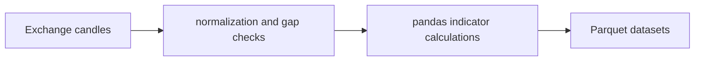

# Market Indicator Pipeline

**OHLCV collection, gap handling and parameterized indicator datasets.**

  [](LICENSE)

[Overview](#overview) · [Quickstart](#quickstart) · [Example](#example) · [Validation](#validation) · [Documentation](#documentation)

## Overview

A Python market-data pipeline for OHLCV collection, gap handling and technical-indicator calculation.

**Stack:** Python · pandas · NumPy · pandas-ta-classic · Parquet · exchange HTTP/WebSocket clients

## Time-series preparation before indicators

| Component | Behavior |
| --- | --- |
| Collect | Exchange candle scripts provide OHLCV input. |
| Repair | Gap-handling scripts examine incomplete time ranges. |
| Calculate | pandas-based indicator functions write derived features to Parquet. |

## Processing path



## Quickstart

```console
python -m venv .venv
# Activate .venv, then:
python -m pip install -r requirements.txt
python -m py_compile backpack_klines.py fill_gaps.py indicator_calculator.py
```

The commands above install prerequisites or run the specified offline checks. Live collection, cloud operations, messaging and trading are separate operational steps when present.

## Example

**Inspect the workflow**

Use [backpack_klines.py](backpack_klines.py) for the collection path, [fill_gaps.py](fill_gaps.py) for gap processing and [indicator_calculator.py](indicator_calculator.py) for feature calculations. Supply the local data paths expected by each script. Keep candle inputs and derived indicator datasets distinguishable.

## Configuration and storage

`requirements.txt` exists and lists NumPy, pandas, pandas-ta-classic, PyArrow, requests and websockets. Versions are not locked or compatibility-certified. Original market datasets and data paths must be supplied separately.

## Repository guide

| Location | Responsibility |
| --- | --- |
| [backpack_klines.py](backpack_klines.py) | Candle collection |
| [fill_gaps.py](fill_gaps.py) | Gap handling |
| [indicator_calculator.py](indicator_calculator.py) | Indicator calculations |
| [requirements.txt](requirements.txt) | Unpinned dependencies |

## Validation

The quickstart lists the declared checks. No passing CI or coverage claim is implied by the technology badges.

## Scope and operational boundaries

`binance_live_unified.py` references missing `binance_select_top.py`, `binance_backfill_warmup.py` and `indicator_cache.py`; it is not a complete runnable entrypoint. Syntax checks do not verify indicator arithmetic, feed coverage or strategy performance.

## Documentation

- The repository guide above links directly to the implementation and configuration files.

## License and attribution

Project-authored source code is licensed under the [MIT License](LICENSE). Third-party components and datasets retain their respective rights and licenses.
